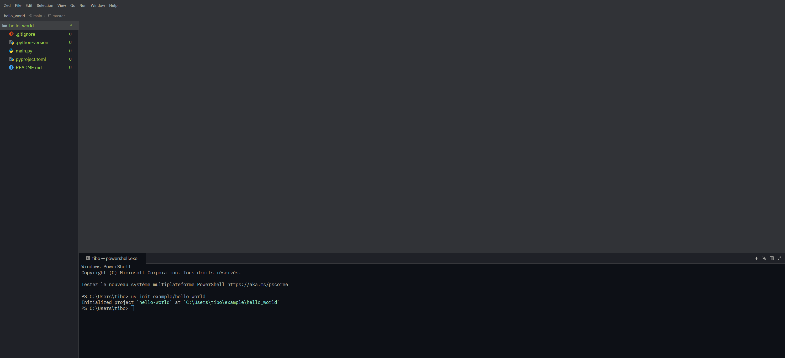

# Guic Formation

The notebook can be consulted at:

https://molab.marimo.io/artifacts/art_HDEYgr6zYUJu8yoY1hh5rU

Note that this is static. If you want to try to modify things, you can install the project on your local machine and run it with `marimo` (see below).

## Installation

The following instructions will help you setup the project on your local machine.

The **simple setup** is easier and the **recommended** way, but may be more obscure if you are not already familiar with git and python.

The **manual setup** explain how to do it manually with more explanations, but require more steps.

Both require you to have `UV` installed on your machine. If you don't have it yet, please follow the instructions [here](https://docs.astral.sh/uv/getting-started/installation/).

## Simple setup

Clone the repository:

```bash
git clone https://github.com/OutSquareCapital/guic-formation.git
```

Go into the newly created folder:

```bash
cd guic-formation
```

Then setup python:

```bash
uv sync
```

Then launch a new notebook in your browser, it may take a few seconds the first time:

```bash
uv run marimo edit formation.py
```

## Manual setup

Note that unlike the simple setup, this will create a **new** project folder, so you may want to copy-paste the contents of this repository into it.

### 1. Initialize your project

Start by installing uv and an IDE of your choice (VScode, Zed, Jetbrains).

Once done, open said IDE, and a terminal in it, then type the following:

```bash
uv init <path/to/your/project/project_name>
```

### 2. Navigate to your project folder

Open said folder with your IDE. You may see something similar as the following:


As you can see, the terminal is still pointing to `tibo`.

Use the following commands, if needed, to point it to your new project.

To go to a specific **sub**-folder:

```bash
cd <path/to/your/project/project_name>
```

To go back to the **parent** folder:

```bash
cd ..
```

### 3. Install the dependencies

```bash
uv add polars plotly[express] plotly-stubs yfinance marimo basedpyright pyochain
```

### 4. Launch a new notebook

Finally, launch a new notebook in your browser, it may take a few seconds the first time:

```bash
uv run marimo edit <file_name>.py
```

## Example

Below is the full output of the commands above, in my case, when setting up the present project.

Notice how I started from the subfolder `pyochain`.

```bash
PS C:\Users\tibo\python_codes\pyochain> cd ..
PS C:\Users\tibo\python_codes> uv init guic-formation
Initialized project `guic-formation` at `C:\Users\tibo\python_codes\guic-formation`
PS C:\Users\tibo\python_codes> cd guic-formation
PS C:\Users\tibo\python_codes\guic-formation> uv add polars plotly[express] plotly-stubs yfinance marimo basedpyright pyochain
Resolved 54 packages in 825ms
Installed 53 packages in 14.94s
 + anyio==4.15.1
 + basedpyright==1.40.2
 + beautifulsoup4==4.15.0
 + certifi==2026.10.19
 + cffi==2.1.1
 + charset-normalizer==3.5.2
 + click==8.5.0
 + curl-cffi==0.16.3
 + docutils==0.23
 + h11==0.16.0
 + idna==3.20
 + itsdangerous==2.2.0
 + jedi==0.20.1
 + loro==1.16.2
 + lxml==6.1.3
 + marimo==0.25.2
 + markdown==3.11.2
 + msgspec==0.22.0
 + multitasking==0.0.13
 + narwhals==2.27.1
 + nodejs-wheel-binaries==24.19.0
 + numpy==2.5.4
 + packaging==26.3
 + pandas==3.0.6
 + parso==0.8.7
 + peewee==4.5.3
 + platformdirs==4.13.5
 + plotly==7.1.0
 + plotly-stubs==0.1.4
 + polars==2.0.0
 + polars-runtime-32==2.0.0
 + protobuf==7.36.2
 + psutil==7.2.2
 + pycparser==3.11
 + pygments==2.21.0
 + pymdown-extensions==11.0.2
 + pyochain==0.28.0
 + python-dateutil==2.9.0.post0
 + python-multipart==0.0.32
 + pytz==2026.5
 + pyyaml==6.0.3
 + pyzmq==27.2.0
 + requests==2.34.2
 + six==1.17.0
 + soupsieve==3.0.3
 + starlette==1.9.0
 + tomlkit==0.15.2
 + typing-extensions==4.16.0
 + tzdata==2026.5
 + urllib3==2.8.0
 + uvicorn==0.54.0
 + websockets==17.3
 + yfinance==1.7.0
PS C:\Users\tibo\python_codes\guic-formation> uv run marimo edit formation.py

        Edit formation.py in your browser 📝

        ➜  URL: http://localhost:2718?access_token=c1jXCS6Vrt1ke-s4grz7-A

        💡 Tip: Build custom notebook views with Marimo Studio
                Guide: https://marimo-team.github.io/marimo-studio/
```
